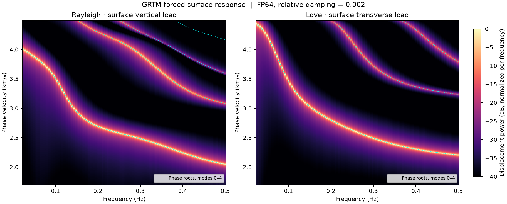
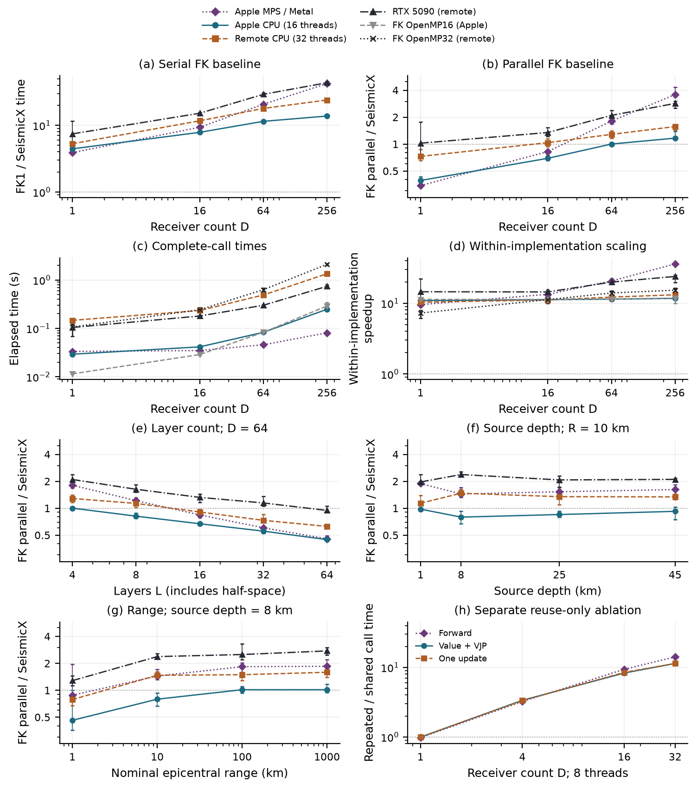

# SeismicX GRTM Community

English | [简体中文](README.zh-CN.md)

**User documentation, binary downloads, and benchmark results for SeismicX GRTM.**
Compute layered-medium Green's functions with C/CPU, NVIDIA CUDA, or Apple Metal,
using one Python interface. This repository provides usage examples and numerical
data; solver implementation source and development history are not distributed here.

[PyPI](https://pypi.org/project/seismicx-grtm/) ·
[Binary downloads](downloads/README.md) · [Quick start](docs/QUICKSTART.md) ·
[FK comparison](benchmarks/fk/README.md) ·
[Report a problem](https://github.com/cangyeone/seismicx-grtm-community/issues)


## Dispersion energy image preview 0.6.0.dev11

[Download](https://github.com/cangyeone/seismicx-grtm-community/releases/tag/v0.6.0.dev11) · [API and physics](docs/DISPERSION_IMAGE.md) · [Accuracy and timing](docs/PERFORMANCE_0.6.0.dev11.md)

Compute complex surface displacements and raw/normalized power from vertical, radial or transverse surface loads, using the forced GRTM wave equation. Native FP64 CPU/CUDA, fused model batches. On a 64×256 grid with 32 layers and B=16, RTX 5090 takes 14.4 ms for Rayleigh and 5.5 ms for Love, 71.7× / 64.5× faster than the same machine's four-thread CPU. Maximum CPU/CUDA response relative L2 difference is 2.25e-13 in the measured cases. Both installed wheels run 158 regression tests with no failures.

The new image API is forward-only; power is squared displacement amplitude, and positive complex-frequency damping broadens poles. Source and receiver are at the surface. MPS remains an explicit CPU FP64 bridge.



## Fused CUDA Earth-model preview 0.6.0.dev10

[Download](https://github.com/cangyeone/seismicx-grtm-community/releases/tag/v0.6.0.dev10) · [API/precision policy](docs/CUDA_GREEN_BATCH.md) · [Full measurements](docs/PERFORMANCE_0.6.0.dev10.md) · [ABI/install](docs/PREVIEW_0.6.0.dev10.md)

Green propagation, explicit VJPs, synthesis and FFT support fused model batches. Strict preserves existing protection by default; explicit `cuda_precision="fast"` admits validated low-frequency overlaps to GPU. For 32 layers, single-model and B=16 forward+gradient calls improve by 12.2× and 13.9× over dev9 wavefield, or 44.7× and 55.8× over legacy reverse AD. Fusion alone at B=16 contributes 1.22–1.36×; the remaining gain mainly comes from the low-frequency path. Extreme frequencies retain protection.

Maximum audited waveform relative error is 1.27e-8 and parameter-column gradient error 1.64e-7; all 48 family accuracy records pass. Both installed wheels run 149 tests. No new CPU/MPS, RF or dispersion speedup is claimed. Surface-wave docs add missing-mode masks, shared train/inference preprocessing, fixed normalization, family holdouts and chunked storage.

## Explicit Green wavefield integral preview 0.6.0.dev9

[Download](https://github.com/cangyeone/seismicx-grtm-community/releases/tag/v0.6.0.dev9) · [Methods/API](docs/GREEN_WAVEFIELD_KERNELS.md) · [Single/batch accuracy and speed](docs/PERFORMANCE_0.6.0.dev9.md) · [ABI/install limits](docs/PREVIEW_0.6.0.dev9.md)

Adds FP64 CPU/CUDA closed-form layer overlap kernels with material, interface, source and receiver terms. Set `vjp_method='wavefield'`; the existing adjoint/default and low-frequency precision safeguards remain. CUDA regular-bin propagation, synthesis, FFT and gradients stay on device. Batch remains per-model native calls. The report includes CPU slowdowns and protected-frequency cases, plus a matched known-root QEDispInv comparison. Both installed wheels run 143 tests (Apple/CUDA skip 26/9).

Two ABIs: Mac CPython 3.12 and Linux CPython 3.13 (glibc≥2.31, CUDA sm120). All host libraries are rebuilt; only the unchanged verified compiled Metal shader is reused. Research/noncommercial licensing is unchanged.

## Eigenfunction and forced-adjoint kernel preview 0.6.0.dev8

[Download](https://github.com/cangyeone/seismicx-grtm-community/releases/tag/v0.6.0.dev8) · [Methods/API](docs/VARIATIONAL_KERNELS.md) · [Measured performance](docs/PERFORMANCE_0.6.0.dev8.md) · [ABI/install limits](docs/PREVIEW_0.6.0.dev8.md)

Adds FP64 Rayleigh/Love energy-integral kernels, analytical group kernels and scalar-observable RF/Green sensitivity interfaces. Parameter counts do not require repeated full propagation; layer/output costs remain. Green retains analytic reverse operators, not a new continuous-volume integral backend. Both installed-wheel suites run 133 tests (Apple/CUDA skip 23/9). Reports retain CUDA phase and single-parameter adjoint slowdowns.

This release contains Mac CPython 3.12 and Linux CPython 3.13 (glibc≥2.31, CUDA sm120) wheels. Other ABIs remain on dev7. Unchanged Metal is reused from the verified dev7 compiled component. Research/noncommercial licensing remains in force.

## Analytic adjoints and CUDA reverse AD preview 0.6.0.dev7

[Compiled wheels](https://github.com/cangyeone/seismicx-grtm-community/releases/tag/v0.6.0.dev7) · [Install](docs/PREVIEW_0.6.0.dev7.md) · [Methods](docs/ANALYTIC_METHODS.md) · [Performance](docs/PERFORMANCE_0.6.0.dev7.md)

Characteristic surface-wave adjoints, native RF material adjoints, Green CUDA reverse AD with GPU synthesis/FFT, and CPU Levin waveform/JVPs. Analytic differentiation and precision guards are retained. Single/batch, CPU/CUDA and old/new comparisons are separate, including workloads that did not improve.

## Phase/group velocity and quadrature preview 0.6.0.dev6

[Compiled wheels](https://github.com/cangyeone/seismicx-grtm-community/releases/tag/v0.6.0.dev6) · [Install](docs/PREVIEW_0.6.0.dev6.md) · [Dispersion evidence](docs/PERFORMANCE_0.6.0.dev6.md) · [Oscillatory quadrature](docs/QUADRATURE_0.6.0.dev6.md)

For 32 layers and B=256, CUDA phase/group velocity is 2.49×/2.43× faster than dev5. CPU Levin is 3.1–3.2× faster than its prior implementation, with joint field/analytic structural-JVP integration and optional method selection; near-field work can use batched Gauss. Adaptive quadrature remains CPU-only. CPU/CUDA ratios and PTAM accuracy scopes are reported separately.

## Device execution and structural derivatives preview 0.6.0.dev5

[Compiled wheels](https://github.com/cangyeone/seismicx-grtm-community/releases/tag/v0.6.0.dev5) · [接口 / APIs](docs/DEVICE_EXECUTION.md) · [速度与精度 / Evidence](docs/PERFORMANCE_0.6.0.dev5.md) · [Install](docs/PREVIEW_0.6.0.dev5.md)

Adds native CPU RF forward/VJP,CUDA analytic Green structural integrals and VJP contractions,
ordered batched backward,reusable CUDA workspaces and reduced RF gradient temporaries.
The execution matrix distinguishes interfaces from actual computation:RF/surface CUDA
forward/derivatives stay on GPU;Green retains low-frequency host precision and FFT;
MPS RF/surface explicitly bridge to CPU FP64,without claiming native GPU acceleration.
Includes unchanged pyfk/disba and same-host multicore CPU comparisons.

## CPU/CUDA search and derivative preview 0.6.0.dev4 (historical)

[Compiled wheels](https://github.com/cangyeone/seismicx-grtm-community/releases/tag/v0.6.0.dev4) · [Install/API](docs/PREVIEW_0.6.0.dev4.md) · [CPU/CUDA performance and accuracy](docs/PERFORMANCE_0.6.0.dev4.md) · [中文](docs/PERFORMANCE_0.6.0.dev4.zh-CN.md)

Optimized GRTM dispersion search preserves FP64 and root precision. The new
report measures Green functions, RF and dispersion, including structural
derivatives, on CPU and CUDA. CPU thread counts and hybrid execution are explicit:
Green structural JVP/VJP remain CPU; RF and surface-wave CUDA derivatives run
on GPU. Results include unchanged disba comparisons, small/batched cases,
individual repetitions and independent precision audits. Stable PyPI is 0.5.1.

**Model batches (2026-10-21):** [batch-scaling report](docs/BATCH_SCALING_20261021.md)
and [API/examples](docs/BATCH_EXECUTION.md) add models/s and per-model latency
for B=1/16/64/256. Native RF/surface CUDA batching and host-scheduled Green
calls are distinguished; Green structural AD remains CPU.

## Complete-method preview 0.6.0.dev3 (historical)

[Download compiled wheels](https://github.com/cangyeone/seismicx-grtm-community/releases/tag/v0.6.0.dev3) · [Installation and API](docs/PREVIEW_0.6.0.dev3.md) · [中文](docs/PREVIEW_0.6.0.dev3.zh-CN.md)

Adds GRTM Rayleigh/Love dispersion, semi-analytic CPU/CUDA sensitivity kernels,
model autograd, and integrates differentiable RF with HMC/DRAM. CPython 3.10–3.14,
Apple Silicon and Linux/WSL x86_64. See the [separate dispersion/kernel and CPU/CUDA benchmarks](docs/SURFACE_WAVE_BENCHMARKS.md):
these measurements precede the dev4 root-search optimization above.
Stable PyPI is still 0.5.1; install a matching preview wheel explicitly.


## Installation

```sh
python -m pip install seismicx-grtm
# Optional receiver-function inversion and framework adapters:
python -m pip install 'seismicx-grtm[rf]'
python -m pip install 'seismicx-grtm[torch,jax]'
```

The current stable release is **0.5.1**, for CPython **3.10–3.14**. Import with
`import grtm`; the command-line program is `grtm`.

| System | Included engines | Requirements |
|---|---|---|
| Apple Silicon Mac | CPU + Metal/MPS | macOS 11+; Apple M4 Max tested |
| Linux / WSL x86_64 | CPU + CUDA | glibc 2.28+; CPU needs no GPU |
| CUDA execution | CUDA 12.8, compute capability 12.0 | Compatible NVIDIA driver; RTX 5090 tested |

No compiler or CUDA toolkit is needed to install a wheel. Native Windows, Intel
Mac, Linux ARM, and older NVIDIA GPU architectures have no matching GPU binary
in this release. See [installation and troubleshooting](docs/INSTALLATION.md).

## Research preview: 0.6.0.dev1

The [binary prerelease](https://github.com/cangyeone/seismicx-grtm-community/releases/tag/v0.6.0.dev1)
adds directional structural JVPs, node-local reverse VJPs, a JAX matrix-free
reverse option and independent Gauss/Levin/guarded-Shanks quadrature.
Read the [preview guide](docs/RESEARCH_PREVIEW.md) · [中文](docs/RESEARCH_PREVIEW.zh-CN.md)
for installation, examples and guarantee limits. The stable PyPI version remains
**0.5.1**; download and install a matching preview wheel explicitly.

Structural derivatives and research quadrature execute on CPU. Fixed-grid
operator derivatives and adaptive quadrature are separate APIs; adaptive
quadrature has no framework backward adapter and does not certify a full
native integral. The existing FK benchmark remains the older frozen experiment.

## First calculation

```python
import grtm

model = grtm.example_model(units="si")
model.update(log2_samples=6, dt=0.2, distances=[10000., 30000.], t0=[0., 0.])
solver = grtm.Solver(backend="cpu")  # also: "cuda", "metal", "mps"
result = solver.forward(
    model, sdr=(20, 40, 60), scalar_moment=1e15, azimuth=45,
    fields=("displacement", "strain", "stress"), threads=4,
)
print(result["displacement"].shape)  # (2, 64, 3)
print(result["field_units"])
```

High-level calculations default to **NED coordinates and SI units**. Without a
source-time history, the results are impulse kernels: displacement m/s, strain
1/s, stress Pa/s. Supply a dimensionless source history to obtain displacement
in m and stress in Pa. The short example demonstrates the interface; select a
sufficient record length and check integration convergence for scientific use.

## User guide

| Task | Guide |
|---|---|
| Install with pip, download wheels, choose CPU/GPU | [Installation](docs/INSTALLATION.md) · [中文](docs/INSTALLATION.zh-CN.md) |
| Build a model, run the CLI, save and read results | [Quick start](docs/QUICKSTART.md) |
| Moment tensor / strike–dip–rake, units, displacement, strain and stress | [Forward API](docs/PYTHON_FORWARD.md) · [中文](docs/PYTHON_FORWARD.zh-CN.md) |
| Large Earth-model batches, Jacobians and VJPs, PyTorch and JAX | [Forward API](docs/PYTHON_FORWARD.md#large-earth-model-batches) |
| Apple GPU and PyTorch MPS selection | [Apple Metal](docs/APPLE_METAL.md) · [中文](docs/APPLE_METAL.zh-CN.md) |
| H–κ initialization → RF waveform fitting → structural inversion | [Receiver functions](docs/RECEIVER_FUNCTIONS.md) · [中文](docs/RECEIVER_FUNCTIONS.zh-CN.md) |
| Input/output and solver options at a glance | [API reference](docs/API_REFERENCE.md) |
| Directional JVP, adjoint VJP, JAX reverse and new quadrature (0.6 preview) | [Preview API guide](docs/RESEARCH_PREVIEW.md) · [中文](docs/RESEARCH_PREVIEW.zh-CN.md) |
| Precision, attenuation conventions, gradient limits | [Numerical notes](docs/NUMERICAL_NOTES.md) · [中文](docs/NUMERICAL_NOTES.zh-CN.md) |
| Installation errors, unexpected amplitudes, memory and speed | [Troubleshooting](docs/TROUBLESHOOTING.md) |

Point-source structural tangents run on the CPU even when CUDA/Metal performs
the forward solve. JAX defaults to dense-Jacobian callbacks; the 0.6 preview
also offers matrix-free reverse mode. PyTorch uses a VJP, with native adjoint
selection added in the preview. The separate elastic receiver-function solver runs in NumPy
on CPU and uses finite differences for structural inversion.

## Performance against FK

The [FK benchmark report](benchmarks/fk/README.md) includes serial FK, our study's
OpenMP FK adaptation, Apple CPU/Metal and remote CPU/RTX 5090 timings. It covers
receiver count, layer count, source depth and epicentral range, and provides all
750 timed calls and 300 warmups as CSV data. Shared remote load and cases where
parallel FK is faster are retained.



The benchmark uses the frozen **0.5.0 scientific snapshot**, not a new timing
campaign for the 0.5.1 PyPI wheels. FK OpenMP is a separately adapted comparator,
not an upstream FK threading feature. Ratios use same-host baselines; they do
not isolate a universal algorithmic speedup. Details and all medians are in the
[report](benchmarks/fk/README.md) and [timing table](benchmarks/fk/TIMINGS.md).

## Downloads and verification

The [v0.5.1 release](https://github.com/cangyeone/seismicx-grtm-community/releases/tag/v0.5.1)
contains the ten wheel assets published on PyPI. Check them against
[SHA256SUMS](downloads/SHA256SUMS). The automatic GitHub “Source code” archives
contain only this documentation/data repository, not the solver implementation.

The release passed installed-package checks across all ten wheels and applicable
real-device tests on Apple M4 Max and RTX 5090. See
[release verification](verification/README.md). Tests of specified models do not
establish accuracy or performance for every Earth model.

The [0.6.0.dev1 preview assets](https://github.com/cangyeone/seismicx-grtm-community/releases/tag/v0.6.0.dev1)
have separate [checksums](downloads/SHA256SUMS-0.6.0.dev1) and
[preview verification](verification/preview-0.6.0.dev1.md). They contain compiled
solver modules and an explicit list of user guides. Solver implementation,
manuscript sources and unpublished experiment archives are excluded.

## Developers

- **Weiping Wang**
- **Xin Liu:** [xinliu_geo@outlook.com](mailto:xinliu_geo@outlook.com)
- **Yuqi Cai:** [caiyuqiming@foxmail.com](mailto:caiyuqiming@foxmail.com)
- **Ziye Yu:** [yuziye@hotmail.com](mailto:yuziye@hotmail.com)

For usage questions and reproducible bug reports, use
[GitHub Issues](https://github.com/cangyeone/seismicx-grtm-community/issues).
Please include package version, OS, Python, backend and a minimal model.

## License and attribution

The binaries and accompanying documentation are distributed under the
[SeismicX GRTM Research and Noncommercial License](LICENSE): noncommercial
scientific research only; commercial use requires separate written permission.
Public access to this repository does not make the solver open source.
Third-party rights are preserved in [NOTICE.md](NOTICE.md) and [licenses](licenses/).

Benchmark references include [Lupei Zhu's FK](https://github.com/rwalkerlewis/fk)
and historical comparisons with [Yunyi Qian's Fortran GRTM](https://github.com/YunyiQian/grtm).
Neither reference implementation is included here or claimed as our work.

When reporting results, identify **SeismicX GRTM**, the package version, backend,
model/sampling settings and relevant integration checks. No article DOI is
claimed by this repository.

## CPU differentiable RF preview (0.6.0.dev2)

[CPU RF instructions](docs/DIFFERENTIABLE_RF_CPU.md) · [中文](docs/DIFFERENTIABLE_RF_CPU.zh-CN.md) · [Release](https://github.com/cangyeone/seismicx-grtm-community/releases/tag/v0.6.0.dev2)

A separate research preview adds CPU differentiable plane-P RFs and public HMC/DRAM interfaces. It provides macOS arm64/Python 3.12 and Linux x86_64/Python 3.13 wheels. The stable release remains unchanged; the new interfaces are not present in the older wheels. The existing solver binaries are preserved and only our CPU RF/Bayesian binary modules are added. The license remains research/noncommercial.

The [FlowRF project](https://github.com/cangyeone/flow-assisted-hmc-receiver-function-inversion) provides a reusable flow-assisted inversion interface and model weights, using GRTM as an external dependency. No third-party authors' inversion source is redistributed in these new RF materials.
