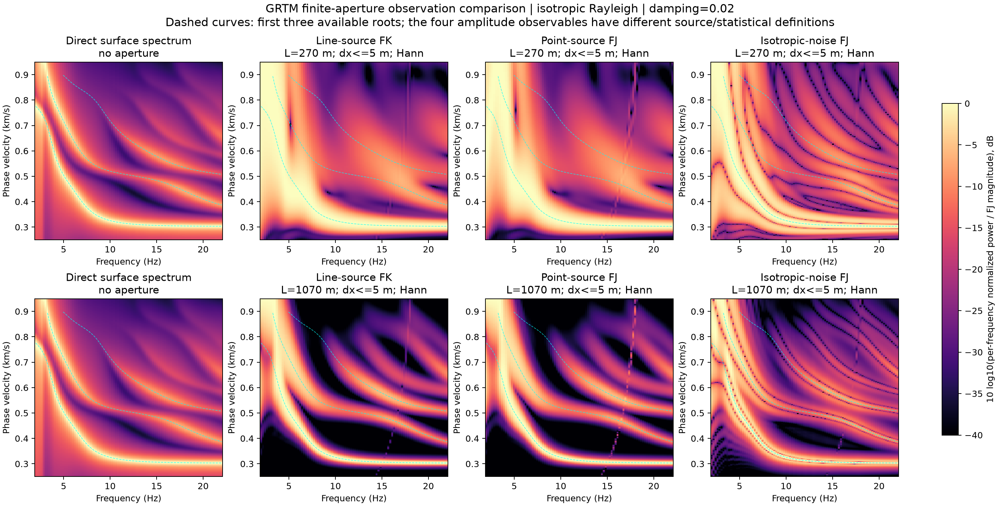

# SeismicX GRTM 用户社区

[English](README.md) | 简体中文

这里提供 **SeismicX GRTM 的详细使用说明、二进制下载和性能对比结果**。
程序用于层状介质格林函数计算，支持 CPU、CUDA 和 Apple Metal/MPS。
仓库中的代码片段是公开接口的使用示例，不包含求解器实现源码或开发历史。


## 解析频散图反演与有限阵列预览 0.6.0.dev12

[下载](https://github.com/cangyeone/seismicx-grtm-community/releases/tag/v0.6.0.dev12) · [接口与物理定义](docs/DISPERSION_IMAGE.zh-CN.md) · [单模型/batch 精度与速度](docs/PERFORMANCE_0.6.0.dev12.zh-CN.md)

CPU/CUDA 解析伴随可直接反演频散图，支持模型、复震源和 source PSD 一阶导数。分别输出 direct response、主动线源 FK、垂直点源 F–J、各向同性随机源互谱 F–J；支持有限孔径、台站几何、窗函数和批量模型，CUDA 数值计算与反传保持同一设备。

F–J 主动源当前限定垂直点力/垂直 Rayleigh 记录；随机源采用文档中定义的有限波数带各向同性 Fourier 载荷模型。空间积分需要检查采样和端点收敛，不支持 VTI/流体/Q 衰减。MPS 仍明确桥接 CPU FP64。下面是各向同性合成示例，不是对参考幻灯片中 SPECFEM/SASEM 的独立复现。



## 频散能量图预览 0.6.0.dev11

[下载](https://github.com/cangyeone/seismicx-grtm-community/releases/tag/v0.6.0.dev11) · [接口与物理含义](docs/DISPERSION_IMAGE.zh-CN.md) · [精度与速度](docs/PERFORMANCE_0.6.0.dev11.zh-CN.md)

用 GRTM 受迫波动方程计算地表垂直、径向或横向载荷下的复位移与原始/归一化幅值平方。支持 FP64 CPU/CUDA、融合模型 batch。64×256 网格、32 层、B=16，RTX 5090 的 Rayleigh / Love 耗时分别为 14.4 / 5.5 ms，相对同机四线程 CPU 提速 71.7× / 64.5×。实测 CPU/CUDA 复响应最大相对 L2 差异 2.25e-13。两个安装包各运行 158 项回归测试，无失败。

新图像接口本次仅正演；能量定义为位移幅值平方，正的复频率偏移用于展宽极点。震源和接收点位于地表。MPS 明确采用 CPU FP64 桥接。


## 跨模型 CUDA 融合预览 0.6.0.dev10

[下载](https://github.com/cangyeone/seismicx-grtm-community/releases/tag/v0.6.0.dev10) · [接口与精度策略](docs/CUDA_GREEN_BATCH.zh-CN.md) · [完整实测](docs/PERFORMANCE_0.6.0.dev10.zh-CN.md) · [安装范围](docs/PREVIEW_0.6.0.dev10.zh-CN.md)

格林函数正演、显式微分、物理合成和 FFT 支持跨模型 CUDA 融合。默认 strict 保留低频保护；显式设置 `cuda_precision="fast"` 将符合条件的低频显式积分放到 GPU。32 层单模型与 B=16 的端到端正演+梯度，相对 dev9 wavefield 分别提速 12.2×、13.9×；相对旧反向 AD 为 44.7×、55.8×。单独融合的 B=16 收益为 1.22–1.36×，其余主要来自低频路径优化。极低频仍保留保护。

本轮最大波形相对误差 1.27e-8，最大参数列梯度相对误差 1.64e-7；48 条跨模型族精度记录全部达标。两平台安装包各运行 149 项测试。CPU/MPS、RF、频散算法无新增提速声明。面波文档已加入缺模掩码、训练/推理预处理一致性、固定归一化、跨模型族留出和分块存储约定。

## 格林函数显式波场积分核预览 0.6.0.dev9

[下载](https://github.com/cangyeone/seismicx-grtm-community/releases/tag/v0.6.0.dev9) · [理论与接口](docs/GREEN_WAVEFIELD_KERNELS.zh-CN.md) · [单模型/batch 精度与速度](docs/PERFORMANCE_0.6.0.dev9.zh-CN.md) · [ABI 与安装限制](docs/PREVIEW_0.6.0.dev9.zh-CN.md)

新增 FP64 CPU/CUDA 层内闭式波场重叠积分，包含材料、界面、震源和接收端项。使用 `vjp_method='wavefield'`；原有伴随、默认策略及低频精度保护保留。CUDA 常规频率的传播、合成、FFT、梯度在同一设备完成，batch 仍逐模型调用。报告保留 CPU 变慢及低频保护的结果，并与 QEDispInv 在相同已知根上比较。两个实际安装 wheel 各运行 143 项测试（Apple/CUDA 分别跳过 26/9 项）。

发布 Mac CPython 3.12 和 Linux CPython 3.13（glibc≥2.31、CUDA sm120）两个 ABI。全部 host 库重新编译，仅复用已校验且未变化的编译 Metal shader。研究/非商业许可不变。

## 特征函数与受迫伴随核预览版 0.6.0.dev8

[下载](https://github.com/cangyeone/seismicx-grtm-community/releases/tag/v0.6.0.dev8) · [公式与接口](docs/VARIATIONAL_KERNELS.zh-CN.md) · [完整实测](docs/PERFORMANCE_0.6.0.dev8.zh-CN.md) · [安装范围](docs/PREVIEW_0.6.0.dev8.zh-CN.md)

新增 FP64 Rayleigh/Love 特征函数能量积分核、解析群速度核，以及 RF/Green 的标量目标敏感核接口。参数数目不增加完整传播次数，但层数和输出仍有成本。Green 保留解析反向算子，并未新增连续体积积分后端。实际安装包通过 Apple/CUDA 各 133 项完整测试（分别跳过 23/9 项）；报告保留 CUDA 相速度略慢和单参数伴随更慢的结果。

本次二进制仅含 Mac CPython 3.12、Linux CPython 3.13（glibc≥2.31，CUDA sm120）。其他 ABI 保留 dev7。Metal 复用已核验且源代码未改动的 dev7 预编译组件；许可仍为研究/非商业。

## 解析伴随与 CUDA 反向 AD 预览版 0.6.0.dev7

[Compiled wheels](https://github.com/cangyeone/seismicx-grtm-community/releases/tag/v0.6.0.dev7) · [Install](docs/PREVIEW_0.6.0.dev7.zh-CN.md) · [Methods](docs/ANALYTIC_METHODS.zh-CN.md) · [Performance](docs/PERFORMANCE_0.6.0.dev7.zh-CN.md)

频散特征方程伴随、RF 原生材料伴随、Green CUDA 反向 AD 与 GPU 合成/FFT，以及 CPU Levin 联合波形/JVP。保持解析微分与精度保护。单模型、批量、CPU/CUDA、旧版/新版分开测量；报告同时列出未提速项。

## 相速度、群速度与振荡积分预览版 0.6.0.dev6

[二进制](https://github.com/cangyeone/seismicx-grtm-community/releases/tag/v0.6.0.dev6) · [安装](docs/PREVIEW_0.6.0.dev6.zh-CN.md) · [频散速度/精度](docs/PERFORMANCE_0.6.0.dev6.zh-CN.md) · [振荡积分](docs/QUADRATURE_0.6.0.dev6.zh-CN.md)

CUDA 32 层 B=256 相/群速度比 dev5 快 2.49×/2.43×。CPU Levin 比原实现快 3.1–3.2×，支持正演/解析结构 JVP 联合积分和可选自动方法选择；近场仍可选批量 Gauss。自适应积分仍在 CPU，CPU/CUDA 比值与 PTAM 对照的误差范围分别列出。

## 设备与结构微分预览 0.6.0.dev5

[Compiled wheels](https://github.com/cangyeone/seismicx-grtm-community/releases/tag/v0.6.0.dev5) · [接口 / APIs](docs/DEVICE_EXECUTION.zh-CN.md) · [速度与精度 / Evidence](docs/PERFORMANCE_0.6.0.dev5.zh-CN.md) · [Install](docs/PREVIEW_0.6.0.dev5.zh-CN.md)

新增原生 CPU RF 正演/微分、CUDA Green 解析结构积分和 VJP 收缩、有序批量 backward、
CUDA 缓冲区复用与 RF 梯度临时量压缩。CPU、CUDA、MPS 接口和实际计算位置有明确区分：
RF/面波 CUDA 正演及微分在 GPU；Green 保留低频扩展精度与主机FFT；MPS RF/面波为
显式 CPU FP64 桥接，不宣称原生 GPU 加速。包括原始 pyfk、disba 和同机多核 CPU 对照。

## CPU/CUDA 寻根与微分预览版 0.6.0.dev4（历史）

[编译包下载](https://github.com/cangyeone/seismicx-grtm-community/releases/tag/v0.6.0.dev4) · [安装与调用](docs/PREVIEW_0.6.0.dev4.zh-CN.md) · [三类正演与微分测试报告](docs/PERFORMANCE_0.6.0.dev4.zh-CN.md)

优化 GRTM 频散寻根，保留 FP64 和原精度要求。报告统一测试格林函数、接收函数、频散及其结构微分的 CPU/CUDA 效率，
明确线程数与实际执行设备：格林函数结构 JVP/VJP 仍在 CPU，接收函数与频散的 CUDA 微分在 GPU。
提供原始 disba 对照、单模型/批处理、逐次计时和独立精度审计。稳定 PyPI 仍为 0.5.1。

**模型批量（2026-10-21）：**新增[批量扩展报告](docs/BATCH_SCALING_20261021.zh-CN.md)
和[接口与示例](docs/BATCH_EXECUTION.zh-CN.md)，给出 B=1/16/64/256 的每模型耗时与每秒模型数，
区分 RF/面波原生 CUDA 批量与格林函数主机调度；格林函数结构微分仍在 CPU。

## 完整方法预览版 0.6.0.dev3（历史）

[编译包下载](https://github.com/cangyeone/seismicx-grtm-community/releases/tag/v0.6.0.dev3) · [安装与调用](docs/PREVIEW_0.6.0.dev3.zh-CN.md) · [速度报告](docs/SURFACE_WAVE_BENCHMARKS.zh-CN.md)

新增基于 GRTM 的 Rayleigh/Love 频散、半解析 CPU/CUDA 敏感核及模型自动微分，并整合可微 RF 与 HMC/DRAM。
提供 CPython 3.10–3.14 的 Apple Silicon 和 Linux/WSL x86_64 编译包。
该版速度报告为寻根优化前的数据，最新结果见上方 dev5 报告。
稳定 PyPI 仍为 0.5.1，请显式安装匹配的预览 wheel。


## 0.6.0.dev1 研究预览版

新增方向 JVP、原生反向 VJP、JAX 无完整 Jacobian 的反向模式，以及独立的
Gauss/Levin/带保护 Shanks 波数积分。安装及详细示例见
[预览版指南](docs/RESEARCH_PREVIEW.zh-CN.md) · [English](docs/RESEARCH_PREVIEW.md)。
从 [GitHub 预览版](https://github.com/cangyeone/seismicx-grtm-community/releases/tag/v0.6.0.dev1)
下载与你的 Python/平台匹配的 wheel；**PyPI 稳定版仍为 0.5.1**。

结构导数和研究积分在 CPU 执行；自适应积分尚无框架 backward，也不认证完整原生积分误差。
新的功能与固定网格导数的边界在指南中单独说明。旧 FK 数据仍对应原冻结实验。
[预览版校验和](downloads/SHA256SUMS-0.6.0.dev1)与
[验证记录](verification/preview-0.6.0.dev1.md)单独保存。
发布包不包含求解器实现、论文源文件或未公开实验归档。

## 安装

```sh
python -m pip install seismicx-grtm
python -m pip install 'seismicx-grtm[rf]'         # 接收函数反演依赖
python -m pip install 'seismicx-grtm[torch,jax]'  # 可选框架接口
```

当前稳定版本 **0.5.1**，导入方式为 `import grtm`，命令行入口为 `grtm`。
支持 Python 3.10–3.14：Apple Silicon macOS 11+ 的 wheel 包含 CPU + Metal，
Linux/WSL x86_64、glibc 2.28+ 的 wheel 包含 CPU + CUDA。
CUDA 仅针对计算能力 12.0，已验证 RTX 5090；CPU 使用不需要 NVIDIA 显卡。
安装不需要编译器或 CUDA toolkit。详见[安装说明](docs/INSTALLATION.zh-CN.md)。

## 快速开始

```python
import grtm

model = grtm.example_model(units="si")
model.update(log2_samples=6, dt=0.2, distances=[10000., 30000.], t0=[0., 0.])
solver = grtm.Solver(backend="cpu")  # 也可选 cuda、metal、mps
result = solver.forward(
    model, sdr=(20, 40, 60), scalar_moment=1e15, azimuth=45,
    fields=("displacement", "strain", "stress"), threads=4,
)
print(result["displacement"].shape)  # (2, 64, 3)
```

高层接口默认 **NED（北、东、下）坐标和 SI 单位**。
未指定震源时间历史时，输出是脉冲格林函数核，单位分别为 m/s、1/s、Pa/s；
加入无量纲震源历史并卷积后才是 m、应变和 Pa。
上例的短时间窗用于演示调用，科学计算需另行检查时间窗和积分收敛。

## 使用文档

- [安装、后端选择与离线下载](docs/INSTALLATION.zh-CN.md)
- [完整入门教程：模型、输出、命令行](docs/QUICKSTART.md)（英文）
- [矩张量/SDR、应力应变、批处理、结构导数、PyTorch/JAX](docs/PYTHON_FORWARD.zh-CN.md)
- [Apple Metal / MPS](docs/APPLE_METAL.zh-CN.md)
- [H–κ → 接收函数全波形拟合 → 结构反演](docs/RECEIVER_FUNCTIONS.zh-CN.md)
- [精度、物理约定与适用范围](docs/NUMERICAL_NOTES.zh-CN.md)
- [常见问题](docs/TROUBLESHOOTING.md)（英文）

点源结构导数使用 CPU 切线计算；选择 CUDA/Metal 正演不意味着结构反向计算在 GPU 上。
JAX 默认导数回调构造稠密 Jacobian，0.6 预览版另提供反向 VJP 模式；
PyTorch 使用 VJP，预览版可显式选择原生反向路径。
接收函数是独立的弹性平面波求解器，在 NumPy/CPU 上运行，结构反演使用差分导数。

## FK 对比和下载

[FK 对比说明](benchmarks/fk/README.zh-CN.md)包括四种设备、单线程基线、
我们添加的 FK OpenMP 多线程适配，以及层数、震源深度、震中距和接收点数的变化。
公开了完整计时表、750 次计时和 300 次预热数据；远程共享负载和慢于 FK 的案例均保留。
这些测量来自锁定的 0.5.0 科学计算版本，不能当作 0.5.1 wheel 的重新测速。


[二进制下载](downloads/README.md) ·
[v0.5.1 Release](https://github.com/cangyeone/seismicx-grtm-community/releases/tag/v0.5.1) ·
[PyPI](https://pypi.org/project/seismicx-grtm/) · [校验和](downloads/SHA256SUMS)

GitHub 自动显示的 “Source code” ZIP/TAR 只打包此文档和数据仓库。
安装程序请选择明确的 `.whl` 附件；求解器实现源码不在这个仓库内。

## 开发人员

- **Weiping Wang**
- **Xin Liu:** [xinliu_geo@outlook.com](mailto:xinliu_geo@outlook.com)
- **Yuqi Cai:** [caiyuqiming@foxmail.com](mailto:caiyuqiming@foxmail.com)
- **Ziye Yu:** [yuziye@hotmail.com](mailto:yuziye@hotmail.com)

使用问题与错误反馈请提交 [Issue](https://github.com/cangyeone/seismicx-grtm-community/issues)，
附版本、系统、Python、后端和最小模型。

## 许可

采用[闭源、仅非商业科研许可](LICENSE)，商业使用需要另行书面授权。
第三方条款见 [NOTICE.md](NOTICE.md)。公开文档不代表求解器开源。
FK 和外部 Fortran GRTM 分别来自 [Lupei Zhu 的 FK](https://github.com/rwalkerlewis/fk)
与 [Yunyi Qian 的 GRTM](https://github.com/YunyiQian/grtm)，不作为本项目作者的作品发布。

## CPU 可微 RF 预览版 0.6.0.dev2

新增 CPU 可微接收函数和 HMC / DRAM 公开接口，支持 macOS arm64 / Python 3.12 与 Linux x86_64 / Python 3.13。旧稳定版及其许可证保持不变；仅在预览轮包中追加自己的 CPU RF / 贝叶斯二进制模块，不纳入开发目录中的其他改动，也不收录第三方作者程序。

[英文说明](docs/DIFFERENTIABLE_RF_CPU.md) · [中文说明](docs/DIFFERENTIABLE_RF_CPU.zh-CN.md) · [下载](https://github.com/cangyeone/seismicx-grtm-community/releases/tag/v0.6.0.dev2) · [FlowRF 用户接口](https://github.com/cangyeone/flow-assisted-hmc-receiver-function-inversion)
